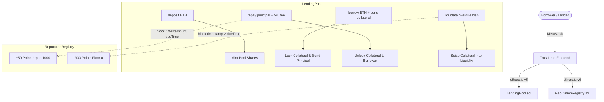

# TrustLend

> **Credit scores for DeFi.**  
> An under-collateralized lending protocol powered by on-chain reputation for Ethereum Sepolia.

[](https://opensource.org/licenses/MIT)
[](https://soliditylang.org/)
[](https://hardhat.org/)
[](https://react.dev/)
[](https://tailwindcss.com/)

---

## 1. The Problem

Traditional DeFi lending protocols (such as Aave, Compound, and MakerDAO) require heavy **over-collateralization** (locking \$150 of crypto to borrow \$100). While this protects pools from bad debt without relying on real-world identity, it fundamentally limits DeFi's capital efficiency:
1. **Capital Trap**: Users who actually need liquidity must already possess more capital than they wish to borrow.
2. **Zero Financial Mobility**: A borrower who has successfully repaid 1,000 loans receives the exact same burdensome terms as a brand-new wallet created 30 seconds ago.
3. **No Credit History**: Hundreds of billions of dollars in transaction history across Ethereum wallets go completely unrewarded.

---

## 2. The Solution: TrustLend

**TrustLend** introduces an immutable, decentralized credit score engine directly onto Ethereum. By establishing a deterministic link between loan repayment history and borrowing parameters, TrustLend enables **under-collateralized loans** down to **50% collateral** with **zero off-chain oracles**:

- **Earned Slowly**: On-time repayments award `+50 points` to a borrower's score.
- **Lost Quickly**: Defaulting on an active loan imposes a severe `-300 points` penalty.
- **Progressive Tiers**: Higher scores unlock lower required collateral ratios and higher maximum borrow caps.
- **Lender Yields**: A flat 5% fee charged on each loan compounds directly into the pool value, rewarding liquidity providers.

---

## 3. Deliberate Design Decisions

The following architectural choices are deliberate trade-offs designed for hackathon robustness and security:

1. **ETH as Both Collateral and Loan Asset**:  
   By using native ETH for both collateral and loans, TrustLend eliminates dependencies on external price oracles (e.g., Chainlink, Pyth). The pool is 100% immune to oracle latency exploits, flash loan price manipulation, and off-chain feed outages.
2. **Flat 5% Fee (No Compounding Interest)**:  
   Rather than complex continuously compounding APR algorithms, TrustLend uses a fixed 5% flat fee on principal. This gives borrowers total predictability on costs and simplifies lender share accounting.
3. **Strict One Active Loan Limit Per Borrower**:  
   A wallet cannot borrow again while an existing loan remains open. This prevents recursive leverage and stops borrowers from over-extending before proving repayment credibility.
4. **Co-Dependent Borrow Limits & Collateral Ratios**:  
   Both maximum loan principal AND collateral ratio scale with score. Even at Platinum tier (50% collateral), loans are strictly capped at 1.0 ETH, limiting maximum single-borrower default exposure to the pool.

---

## 4. System Architecture

```
 +-------------------------------------------------------------------------+
 |                               METAMASK                                  |
 |       (Account 1: Lender  |  Account 2: Good  |  Account 3: Defaulter)  |
 +------------------------------------+------------------------------------+
                                      |
                                      v
 +------------------------------------+------------------------------------+
 |                      TRUSTLEND FRONTEND DAPP                            |
 |  React 18 + Vite + Tailwind CSS + Framer Motion + ethers v6 + Recharts  |
 +------------------------------------+------------------------------------+
                                      |
                      JSON-RPC calls & signed txs
                                      |
                                      v
 +------------------------------------+------------------------------------+
 |                       ETHEREUM SEPOLIA EVM                              |
 |                                                                         |
 |   +-----------------------------------------------------------------+   |
 |   |                     ReputationRegistry.sol                      |   |
 |   |  - Tracks borrower scores: 0 to 1000                            |   |
 |   |  - Default score: 100 (Newcomer)                                |   |
 |   |  - onTimeRepayment(+50) & defaulted(-300)                       |   |
 |   |  - 5 Tier Configurations & Math Table                           |   |
 |   +--------------------------------+--------------------------------+   |
 |                                    ^                                    |
 |                   Authorized calls | on repay / liquidate               |
 |                                    v                                    |
 |   +--------------------------------+--------------------------------+   |
 |   |                       LendingPool.sol                           |   |
 |   |  - ERC-4626 style pool shares & liquidity accounting            |   |
 |   |  - deposit() & withdraw(shares)                                 |   |
 |   |  - borrow(amount, duration) with tier collateral check          |   |
 |   |  - repay(loanId) releases collateral & triggers +50 reward      |   |
 |   |  - liquidate(loanId) seizes collateral & triggers -300 penalty  |   |
 |   +-----------------------------------------------------------------+   |
 +-------------------------------------------------------------------------+
```

### Mermaid Flowchart



---

## 5. Tier System & Table

A wallet interacting with TrustLend for the first time starts with a credit score of **100 points** in Tier 0 (Newcomer).

| Tier Index | Tier Name | Score Range | Collateral Ratio | Max Borrow Limit | Description |
|:---:|:---|:---:|:---:|:---:|:---|
| **0** | **Newcomer** | 0 – 199 | **150%** (15000 bps) | **0.05 ETH** | Baseline tier. Over-collateralized starting ground for fresh addresses. |
| **1** | **Bronze** | 200 – 399 | **125%** (12500 bps) | **0.10 ETH** | Lower collateral barrier; 2x higher borrow cap. |
| **2** | **Silver** | 400 – 599 | **100%** (10000 bps) | **0.25 ETH** | 1:1 Parity collateral; borrow up to 0.25 ETH safely. |
| **3** | **Gold** | 600 – 799 | **75%** (7500 bps) | **0.50 ETH** | **Under-collateralized!** Only 75% collateral required to borrow. |
| **4** | **Platinum** | 800 – 1000 | **50%** (5000 bps) | **1.00 ETH** | **Premier tier.** 50% collateral required with maximum 1.00 ETH loan cap. |

---

## 6. Money Flow & Share Math

### Pool Share Accounting
The pool operates with share-based accounting modeled after ERC-4626:
- $\text{Liquidity} = \text{address(this).balance} - \text{totalCollateralLocked}$
- $\text{PoolValue} = \text{Liquidity} + \text{totalBorrowed}$
- When depositing $E$ ETH:
  - If $\text{totalShares} == 0$: $\text{sharesToMint} = E$
  - If $\text{totalShares} > 0$: $\text{sharesToMint} = \frac{E \times \text{totalShares}}{\text{PoolValue}_{\text{before}}}$
- When withdrawing $S$ shares:
  - $\text{Payout} = \frac{S \times \text{PoolValue}}{\text{totalShares}}$
  - Payout is strictly bounded by available unencumbered liquidity: $\text{Payout} \le \text{Liquidity}$.

### Example 1: On-Time Repayment (Lender Fee Accrual)
1. Pool starts with 5.0 ETH deposited by Lender (5.0 shares).
2. Borrower at Platinum tier borrows 1.0 ETH, depositing 0.5 ETH collateral (50%).
3. Outstanding principal: `totalBorrowed = 1.0 ETH`.
4. Borrower repays on time: pays $1.0\text{ (principal)} + 0.05\text{ (5\% fee)} = 1.05\text{ ETH}$.
5. Borrower receives back their 0.5 ETH collateral.
6. The 0.05 ETH fee remains in pool liquidity.
7. Pool value is now **5.05 ETH** across 5.0 shares! Each share is now worth $1.01\text{ ETH}$.

### Example 2: Default & Liquidation
1. Borrower borrows 0.20 ETH at Silver tier (100% collateral = 0.20 ETH).
2. Borrower fails to repay before `dueTime`.
3. Any user calls `liquidate(loanId)`.
4. `totalBorrowed` decreases by 0.20 ETH.
5. The 0.20 ETH locked collateral is transferred from `totalCollateralLocked` into available pool liquidity.
6. Reputation Registry is called: borrower's credit score drops by 300 points.

---

## 7. Smart Contract Functions

### `ReputationRegistry.sol`
| Function | Visibility | Modifiers | Description |
|:---|:---|:---|:---|
| `setLendingPool(address)` | External | `onlyOwner` | One-time authorization of the lending pool contract. |
| `getScore(address)` | Public View | None | Returns user score in range [0, 1000] (defaults to 100). |
| `getTier(address)` | External View | None | Returns tier index (0-4). |
| `getTierConfig(uint8)` | Public Pure | None | Returns tier label, collateral ratio bps, and max borrow. |
| `getUserTierDetails(address)` | External View | None | Aggregated score and tier parameters for a user. |
| `onTimeRepayment(address)` | External | `onlyLendingPool` | Increases user score by +50 (capped at 1000). |
| `defaulted(address)` | External | `onlyLendingPool` | Penalizes user score by -300 (floored at 0). |
| `seedScore(address, uint256)` | External | `onlyOwner` | **Demo shortcut**: seeds score when `demoMode == true`. |

### `LendingPool.sol`
| Function | Visibility | Modifiers | Description |
|:---|:---|:---|:---|
| `deposit()` | External Payable | `nonReentrant` | Supply ETH and receive proportional liquidity shares. |
| `withdraw(uint256)` | External | `nonReentrant` | Burn shares to redeem proportional ETH liquidity. |
| `borrow(uint256, uint256)` | External Payable | `nonReentrant` | Borrow ETH against required tier collateral and duration. |
| `repay(uint256)` | External Payable | `nonReentrant` | Repay loan principal + 5% fee and unlock collateral. |
| `liquidate(uint256)` | External | `nonReentrant` | Seize collateral of overdue loan into pool liquidity. |
| `getLiquidity()` | Public View | None | Returns unencumbered ETH balance in pool. |
| `getPoolValue()` | Public View | None | Returns liquidity + outstanding loan principals. |
| `sharesValue(address)` | External View | None | Value in ETH of a lender's share balance. |
| `getPoolStats()` | External View | None | Aggregate metrics (liquidity, borrowed, utilization, loans). |

---

## 8. Security & Engineering Best Practices

- **Reentrancy Protection**: All state-modifying functions that transfer ETH (`deposit`, `withdraw`, `borrow`, `repay`, `liquidate`) utilize OpenZeppelin's audited `ReentrancyGuard` (`nonReentrant`).
- **Checks-Effects-Interactions (CEI)**: Internal state, shares, active loan flags, and accounting values are updated **before** any external ETH transfer occurs.
- **Double-Settle Prevention**: Loans are validated with custom errors (`LoanNotActive`, `ActiveLoanExists`) ensuring a settled loan cannot be repaid or liquidated twice.
- **Strict Access Control**: Only the authorized `LendingPool` contract can invoke `onTimeRepayment` or `defaulted` on the `ReputationRegistry`.
- **Zero Admin Backdoors**: The `LendingPool` contract contains **zero** owner withdrawal functions or fee skimming backdoors. Lender capital is entirely owned by share-holders.

---

## 9. Honest Protocol Limitations

For hackathon evaluation, we transparently disclose current trade-offs:
1. **Sybil Resistance**: A user can create a brand-new wallet to start fresh at score 100. *Mitigation in v1*: Initial tier (Newcomer) is over-collateralized (150%), meaning a new wallet cannot profit by defaulting.
2. **Score Farming Risk**: A malicious actor could take and repay multiple tiny loans to build score, then default on a larger under-collateralized loan. *Mitigation in v1*: The cap on loans scales slowly and maximum loan at Platinum is limited to 1.0 ETH.
3. **Pool Insolvency on Under-Collateralized Default**: In Platinum tier (50% collateral), a default seizes 0.5 ETH of collateral against 1.0 ETH borrowed, leaving a 0.5 ETH deficit absorbed by the pool.
4. **No Financial Privacy**: All repayment history and scores are public on-chain.
5. **Single Asset (ETH)**: Does not support ERC-20 stablecoins (e.g. USDC, DAI) in this initial version.

---

## 10. Future Scope & Roadmap

1. **Decentralized Identity (EAS & Gitcoin Passport)**: Integrate Ethereum Attestation Service (EAS) and Gitcoin Passport / WorldID to bind scores to unique human identities, eliminating Sybil attacks.
2. **Zero-Knowledge Credit Proofs (zk-SNARKs)**: Allow borrowers to prove they have a Platinum tier score without revealing their wallet address or transaction history publicly.
3. **Dynamic Interest Rate Curve**: Transition from flat 5% fee to a utilization-based interest rate curve (kink model like Aave).
4. **Protocol Reserve Fund**: Dedicate 20% of loan fees to a first-loss capital reserve to buffer liquidity providers against under-collateralized defaults.
5. **Multi-Asset Lending with Chainlink Oracles**: Support borrowing stablecoins (USDC) against staked ETH (wstETH) or token baskets.
6. **Cross-Protocol Score Oracle**: Provide an on-chain interface so other DeFi protocols can query TrustLend credit scores for custom under-collateralized margin or NFT lending.

---

## 11. Quick Start Guide

### Prerequisites
- Node.js v18+ or v20+
- MetaMask browser extension

### Install & Test Contracts
```bash
cd contracts
npm install
npx hardhat test
```

### Run Frontend
```bash
cd ../frontend
npm install
npm run dev
```
Open [http://localhost:3000](http://localhost:3000).
